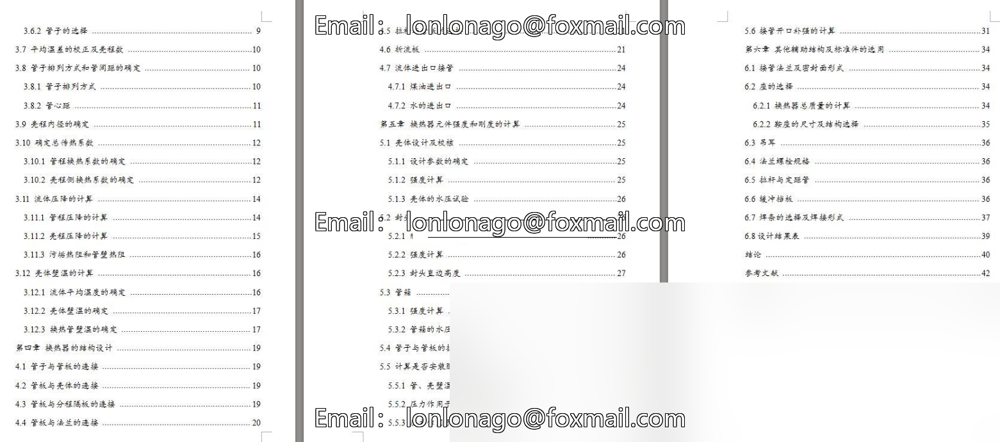

# 544 oil cooler CAD design drawing

## Body

544 Oil Cooler CAD design drawing 544 Oil Cooler design design drawing oil cooler design CAD drawing
This material includes CAD drawings and instructions
The instructions first determine the structure form of the equipment and the material of the shell passage and tube passage based on the given design temperature and design pressure, then determine the material of the heat exchange pipe based on the material nature and heat transfer area, then design the strength of each component of the heat exchanger, etc.

The document includes CAD figures, design diagrams, and instructions for a 544 oil-cooler; the instructions detail structural form, material selection, component strength design and multiple calculations.

<!-- AI_ENRICHED -->

## Images

## Payment

Here is a pay link on Stripe ( https://buy.stripe.com/3cs8yP7sY87d0vu9AB ). Please contact me lonlonago@foxmail.com after funding $89, and I will send you a complete data files , thank you!

